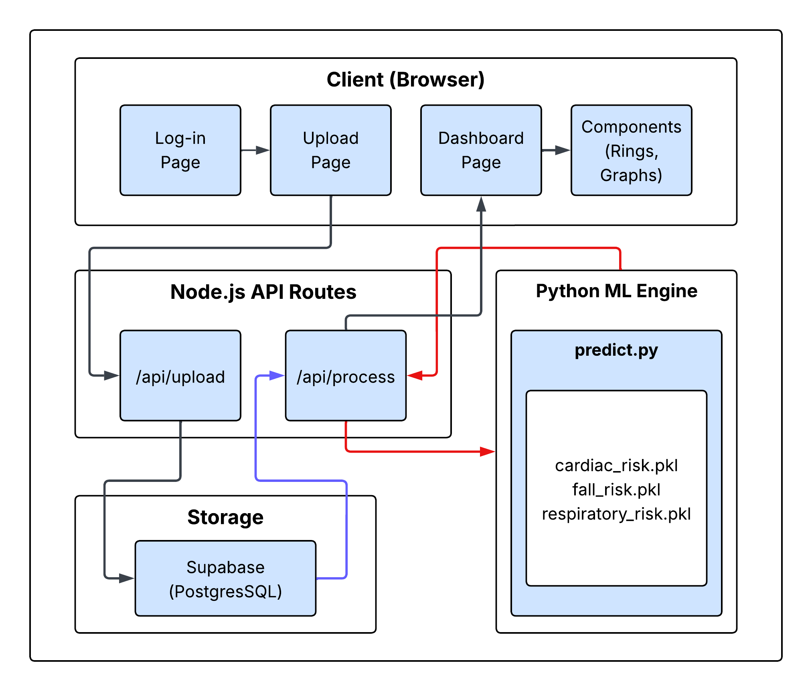

<div align="center">

# 


**AI-Powered Health Risk Prediction for Elderly Care**

[](https://nextjs.org/)
[](https://react.dev/)
[](https://www.typescriptlang.org/)
[](https://tailwindcss.com/)
[](https://www.python.org/)
[](https://supabase.com/)
[](./LICENSE)

<br />

GeriRisk is a wearable-data health monitoring system designed for **senior care**. It ingests real-time metrics — heart rate, SpO₂, steps, sleep, and temperature — and uses **machine-learning models** to predict cardiac stress, fall likelihood, and respiratory irregularities. Results are presented through an intuitive, alert-driven dashboard so caregivers can act fast.

<br />

[Features](#features) · [Tech Stack](#tech-stack) · [Architecture](#architecture) · [Project Structure](#project-structure) · [Getting Started](#getting-started)· [API Reference](#api-reference) · [License](#license)

</div>

---

## Features
<p align="center">

| Category                | Highlights                                                                                          |
| ----------------------- | --------------------------------------------------------------------------------------------------- |
| **ML Risk Prediction**  | Cardiac stress · Fall likelihood · Respiratory risk — each scored with High / Moderate / Low levels |
| **CSV Upload Pipeline** | Drag-and-drop wearable data upload → preprocessing → feature extraction → ML inference              |
| **Real-Time Dashboard** | Sparkline charts · Activity rings · Sleep timeline & distribution panels · Risk score cards         |
| **Intelligent Alerts**  | Data-driven alert engine with contextual clinical messages and severity-based prioritization        |
| **Book Appointment**    | In-dashboard appointment scheduling with doctor availability based on selected dates               |
| **Data Persistence**    | Supabase-backed storage for all uploaded health records                                             |
| **Apple-Inspired UI**   | Clean, minimal design with Inter typography, smooth Framer Motion animations & glassmorphic cards    |

</p>

---

## Tech Stack

### Frontend
<div align="center">

| Technology         | Purpose                                      |
| ------------------ | -------------------------------------------- |
| **Next.js 16**     | React framework with App Router & API routes |
| **React 19**       | Component library with the React Compiler    |
| **TypeScript 5**   | Type-safe development                        |
| **Tailwind CSS 4** | Utility-first styling with CSS variables      |
| **Framer Motion**  | Smooth, Apple-like animations & transitions   |
| **Recharts**       | Data visualization (sparklines, charts)      |
| **Lucide React**   | Icon system                                  |
| **Inter Font**     | Typography (via next/font/google)            |

</div>


### Backend & ML

<div align="center">

| Technology             | Purpose                                                       |
| ---------------------- | ------------------------------------------------------------- |
| **Next.js API Routes** | `/api/upload` and `/api/process` endpoints                    |
| **Python 3**           | ML inference runtime                                          |
| **scikit-learn**       | Pre-trained risk models (Random Forest / Logistic Regression) |
| **NumPy & Joblib**     | Numerical computation & model serialization                   |

</div>

### Infrastructure

<div align="center">

| Technology    | Purpose                              |
| ------------- | ------------------------------------ |
| **Supabase**  | PostgreSQL database + authentication |
| **PapaParse** | Client-side CSV parsing              |

</div>

---

## Architecture





---

## Project Structure

```
GeriRisk/
├── geririsk-ai/                  # Main application
│   ├── ml/                       # Machine learning module
│   │   ├── models/               # Pre-trained model files (.pkl)
│   │   │   ├── cardiac_risk_model.pkl
│   │   │   ├── cardiac_scaler.pkl
│   │   │   ├── fall_risk_model.pkl
│   │   │   ├── fall_scaler.pkl
│   │   │   ├── respiratory_risk_model.pkl
│   │   │   └── respiratory_scaler.pkl
│   │   └── predict.py            # Inference entry point
│   ├── public/                   # Static assets & branding
│   ├── src/
│   │   ├── app/
│   │   │   ├── api/
│   │   │   │   ├── upload/       # CSV upload endpoint
│   │   │   │   └── process/      # ML processing endpoint
│   │   │   ├── dashboard/        # Patient dashboard page
│   │   │   ├── upload/           # Upload wizard page
│   │   │   ├── login/            # Authentication page
│   │   │   ├── page.tsx          # Landing page
│   │   │   ├── layout.tsx        # Root layout
│   │   │   └── globals.css       # Global styles
│   │   ├── components/
│   │   │   ├── ActivityRing.tsx   # Circular progress rings
│   │   │   ├── AlertPanel.tsx     # Risk alert notifications
│   │   │   ├── BookAppointment.tsx # Doctor appointment scheduler
│   │   │   ├── DataTable.tsx      # Tabular data display
│   │   │   ├── MetricCard.tsx     # KPI metric tiles
│   │   │   ├── RiskCard.tsx       # Risk score display cards
│   │   │   ├── SleepDistribution.tsx
│   │   │   ├── SleepTimeline.tsx
│   │   │   └── SparklineChart.tsx
│   │   └── lib/
│   │       ├── api.ts            # Client-side API helpers
│   │       ├── csvParser.ts      # CSV parsing utilities
│   │       ├── features.ts       # Feature engineering logic
│   │       ├── generateAlerts.ts # Intelligent alert generation engine
│   │       ├── preprocess.ts     # Data preprocessing pipeline
│   │       └── supabaseClient.ts # Supabase client singleton
│   ├── package.json
│   ├── tsconfig.json
│   └── next.config.ts
├── requirements.txt              # Python dependencies
├── LICENSE                       # MIT License
└── README.md
```

---

## Getting Started

### Prerequisites

<div align="center">

| Tool                 | Version                               |
| -------------------- | ------------------------------------- |
| **Node.js**          | ≥ 18.x                                |
| **npm**              | ≥ 9.x                                 |
| **Python**           | ≥ 3.10                                |
| **Supabase Account** | [supabase.com](https://supabase.com/) |

</div>

### 1. Clone the Repository

```bash
git clone https://github.com/atharvapawar9/GeriRisk.git
cd GeriRisk
```

### 2. Install Python Dependencies

```bash
pip install -r requirements.txt
```

### 3. Install Node.js Dependencies

```bash
cd geririsk-ai
npm install
```

### 4. Configure Environment Variables

Create a `.env.local` file inside `geririsk-ai/`:

```env
NEXT_PUBLIC_SUPABASE_URL=your_supabase_project_url
NEXT_PUBLIC_SUPABASE_ANON_KEY=your_supabase_anon_key
```

> **Note:** You can find these values in your [Supabase project dashboard](https://app.supabase.com/) under **Settings → API**.

### 5. Run the Development Server

```bash
npm run dev
```

The app will be available at **[http://localhost:3000](http://localhost:3000)**.

---

## API Reference

### `POST /api/upload`

Upload a CSV file containing wearable health data.

<div align="center">

| Parameter | Type       | Description                  |
| --------- | ---------- | ---------------------------- |
| `file`    | `FormData` | CSV file with health metrics |

</div>

### `POST /api/process`

Run ML inference on preprocessed feature data.

**Request Body (JSON):**

```json
{
  "avgHeartRate": 78,
  "maxHeartRate": 120,
  "minHeartRate": 55,
  "minSpO2": 94,
  "totalSteps": 3200,
  "recordCount": 48
}
```

**Response:**

```json
{
  "cardiacRisk": { "score": 0.312, "level": "Low" },
  "fallRisk": { "score": 0.651, "level": "Moderate" },
  "respiratoryRisk": { "score": 0.142, "level": "Low" }
}
```


---


## Model training

`ml-api/train.py` retrains the three classifiers that the ML API serves. It
writes to `ml-api/models_retrained/` and never touches the committed artefacts
in `ml-api/models/`; it refuses to, and a test checks that.

```bash
cd ml-api
pip install -r requirements-train.txt
python train.py                  # all three, full data
python train.py --only fall      # one model
python train.py --sample-size 120 --no-mlflow    # quick smoke run
```

Runs are logged to MLflow through its file backend, in `mlruns/` at the
repository root (gitignored). Browse them with `mlflow ui`.

### Data

Three CSVs of 999 rows each, in `ml-api/training_data/`. They were copied
unmodified from [`atharvapawar9/GeriRisk`](https://github.com/atharvapawar9/GeriRisk)
(`GeriRiskCSVs/`, commit `8c0d0e81`), by **atharvapawar9**, licensed **MIT**
(`Copyright (c) 2026 Atharva`).

### How the committed artefacts were reverse-engineered

Nothing in the repository recorded how `ml-api/models/*.pkl` were produced, so
the settings below were recovered from the files themselves.

| Model | Algorithm | Settings read off the artefact |
|-------|-----------|-------------------------------|
| Cardiac | `RandomForestClassifier` | `n_estimators=200`, `class_weight="balanced"`, `random_state=42`, 6 features |
| Fall | `LogisticRegression` | `class_weight="balanced"`, `random_state=42`, lbfgs, `max_iter=100`, 3 features |
| Respiratory | `LogisticRegression` | `class_weight="balanced"`, `random_state=42`, lbfgs, `max_iter=100`, 3 features |

All six artefacts carry `_sklearn_version == "1.6.1"`, which is why
`ml-api/requirements.txt` now pins that version exactly.

**The split.** All three `StandardScaler`s report `n_samples_seen_ == 699` out
of 999 rows. The split was found by brute force rather than assumed: for every
combination of `test_size` in {`0.3`, `300`}, `random_state` from 0 to 200, and
`stratify` on and off, the scaler was refit and its `mean_` and `scale_`
compared with the committed values. Exactly one combination reproduces all
three to within `1e-9`:

```python
train_test_split(X, y, test_size=0.3, random_state=42, stratify=y)
```

The unstratified variants give the same 699 row count but different statistics,
so `stratify=y` is part of the answer, not a guess. `train.py` uses this split.

**What reproduces, and what does not.** Retraining on that split reproduces
both `LogisticRegression` models' held-out predictions exactly, but their
coefficients differ by up to 0.14 (roughly 3%). The iteration count is
identical (`n_iter_` 12 for fall, 10 for respiratory), which points at a
different SciPy L-BFGS-B build rather than different data or settings; it was
not pinned down further. The cardiac random forest does **not** reproduce, and
its own tree shapes say it was not fitted on those 699 rows: the committed
forest's depth histogram is `{1: 22, 2: 94, 3: 71, 4: 13}`, while every
699-row fit of these settings gives `{2: 159, 3: 37, 4: 4}`. 347 further
configurations (full data and other split sizes, split seeds and forest seeds)
were tried and none matched exactly. Its training set is therefore unknown.

### The labels are rule-derived, so the metrics mean very little

Class balance is near even, so the scores are not a majority-class artefact:

| Dataset | Rows | Label 0 | Label 1 |
|---------|------|---------|---------|
| Cardiac | 999 | 448 (44.8%) | 551 (55.2%) |
| Fall | 999 | 499 (49.9%) | 500 (50.1%) |
| Respiratory | 999 | 499 (49.9%) | 500 (50.1%) |

A **depth-1** decision tree, that is a single threshold on a single column, was
fitted on the 699 training rows and scored on the 300 held-out rows:

| Dataset | The whole tree | Held-out accuracy |
|---------|----------------|-------------------|
| Fall | `totalSteps <= 120` then 1, else 0 | **1.0000** |
| Respiratory | `avgHeartRate <= 91.95` then 0, else 1 | **1.0000** |
| Cardiac | `totalSteps <= 202.5` then 1, else 0 | **0.9933** |

Allowing depth 2 or 3 changes nothing: the extra splits are never used.

**These labels are synthetic.** They were generated by a threshold rule, not
observed in patients. Two of the three are recovered perfectly by one
comparison, and the third misses 2 of 300 rows. Everything downstream follows
from that.

### Measured results

`python train.py` on the full data, metrics on the 300 held-out rows:

| Model | Precision | Recall | F1 | ROC AUC | TP / FP / FN / TN |
|-------|-----------|--------|----|---------|-------------------|
| Cardiac | 1.0000 | 0.9879 | 0.9939 | 1.0000 | 163 / 0 / 2 / 135 |
| Fall | 1.0000 | 1.0000 | 1.0000 | 1.0000 | 150 / 0 / 0 / 150 |
| Respiratory | 1.0000 | 1.0000 | 1.0000 | 1.0000 | 150 / 0 / 0 / 150 |

See [`EXPLAIN.md`](./EXPLAIN.md) for what each metric means, worked through
these numbers.

### Limits

- **No clinical claim is made or supported.** These numbers measure how well a
  model recovers a threshold rule from data generated by that rule. They say
  nothing about cardiac, fall or respiratory risk in real patients, and nothing
  about this service's accuracy in use. Do not read them as validation.
- Perfect or near-perfect scores are the symptom, not the achievement. A real
  dataset would not behave like this.
- The held-out rows come from the same generated distribution as the training
  rows, so this is not an out-of-distribution test of any kind.
- The three datasets have no patient identifier, so rows from one person could
  sit on both sides of the split. With generated data this does not matter; with
  real data it would invalidate the split entirely.
- The cardiac artefact in `models/` cannot be reproduced (above), so the
  retrained cardiac model is not a drop-in replacement for it. `train.py`
  deliberately writes elsewhere; swapping artefacts into `models/` is a separate
  decision that needs its own testing against the running service.
- `main.py` passes plain NumPy arrays to scalers that were fitted on named
  DataFrame columns, so scikit-learn logs a `UserWarning` on every request. It
  is harmless, the column order does match, and it is left alone here because
  changing inference is out of scope for this change.

---


## License

Distributed under the **MIT License**. See [`LICENSE`](./LICENSE) for more information.

Training data under `ml-api/training_data/` is from
[`atharvapawar9/GeriRisk`](https://github.com/atharvapawar9/GeriRisk) by
**atharvapawar9**, also MIT licensed. See
[`ml-api/training_data/README.md`](./ml-api/training_data/README.md).

---

## Design Philosophy

GeriRisk's frontend follows an modern design language:

- **Typography**: Inter font family (closest to SF Pro available via Google Fonts)
- **Color Palette**: Deep brand blue `#0000c9` primary with `#a8bcff` accents, Apple's `#f5f5f7` warm gray for section backgrounds, `#1d1d1f` charcoal footer
- **Corners & Shadows**: Large `1rem` border-radius with soft, diffused box-shadows
- **Animations**: Smooth Framer Motion entrances with custom cubic-bezier easing curves
- **Glass Effects**: Frosted-glass navbar with `backdrop-blur` and `backdrop-saturate`

---

<div align="center">


</div>
